# Thanushiyan Kanthasami

**Defensive & offensive security · SOC labs · Threat hunting · CTFs**

<a href="https://tryhackme.com/p/MrDarkWing"><picture><source media="(prefers-color-scheme: dark)" srcset="./assets/btn-tryhackme-dark.svg"/><source media="(prefers-color-scheme: light)" srcset="./assets/btn-tryhackme-light.svg"/></picture></a>
<a href="https://linkedin.com/in/thanushiyan-kanthasami"><picture><source media="(prefers-color-scheme: dark)" srcset="./assets/btn-linkedin-dark.svg"/><source media="(prefers-color-scheme: light)" srcset="./assets/btn-linkedin-light.svg"/></picture></a>
<a href="https://github.com/Deadsecnote1"><picture><source media="(prefers-color-scheme: dark)" srcset="./assets/btn-github-dark.svg"/><source media="(prefers-color-scheme: light)" srcset="./assets/btn-github-light.svg"/></picture></a>
<a href="mailto:davidthanu1006@gmail.com"><picture><source media="(prefers-color-scheme: dark)" srcset="./assets/btn-email-dark.svg"/><source media="(prefers-color-scheme: light)" srcset="./assets/btn-email-light.svg"/></picture></a>

 

I’m a BSc IT undergraduate at the University of Moratuwa seeking a cybersecurity internship starting in **January 2027**. My defensive work focuses on SOC investigations, network threat hunting, and detection engineering with Wazuh, Sysmon, and Wireshark. I practice offensive security through CTFs and controlled labs on TryHackMe.

## Selected projects

- [Network Threat Hunting](https://github.com/Deadsecnote1/network-threat-hunting) — An ongoing Wireshark-based investigation of a training PCAP. Broad analysis and incident reporting are in progress.
- [Mini SOC](https://github.com/Deadsecnote1/mini-soc) — Validated a custom Wazuh detection using a controlled Windows failed logon and documented the alert in IR-001.
- [IP Scanner](https://github.com/Deadsecnote1/ipscanner) — A Python CLI for checking IPv4 host reachability and TCP ports in a lab.

 

<picture><source media="(prefers-color-scheme: dark)" srcset="./assets/stack-dark.svg"/><source media="(prefers-color-scheme: light)" srcset="./assets/stack-light.svg"/></picture>

  

<picture><source media="(prefers-color-scheme: dark)" srcset="https://raw.githubusercontent.com/Deadsecnote1/Deadsecnote1/output/activity-dark.svg"/><source media="(prefers-color-scheme: light)" srcset="https://raw.githubusercontent.com/Deadsecnote1/Deadsecnote1/output/activity-light.svg"/></picture>

  

<a href="mailto:davidthanu1006@gmail.com"><picture><source media="(prefers-color-scheme: dark)" srcset="./assets/footer-dark.svg"/><source media="(prefers-color-scheme: light)" srcset="./assets/footer-light.svg"/></picture></a>
