<picture><source media="(prefers-color-scheme: dark)" srcset="./assets/hero-dark.svg"/><source media="(prefers-color-scheme: light)" srcset="./assets/hero-light.svg"/></picture>

<a href="https://tryhackme.com/p/MrDarkWing"><picture><source media="(prefers-color-scheme: dark)" srcset="./assets/btn-tryhackme-dark.svg"/><source media="(prefers-color-scheme: light)" srcset="./assets/btn-tryhackme-light.svg"/></picture></a>
<a href="https://linkedin.com/in/thanushiyan-kanthasami"><picture><source media="(prefers-color-scheme: dark)" srcset="./assets/btn-linkedin-dark.svg"/><source media="(prefers-color-scheme: light)" srcset="./assets/btn-linkedin-light.svg"/></picture></a>
<a href="https://github.com/Deadsecnote1"><picture><source media="(prefers-color-scheme: dark)" srcset="./assets/btn-github-dark.svg"/><source media="(prefers-color-scheme: light)" srcset="./assets/btn-github-light.svg"/></picture></a>
<a href="mailto:thanushiyan.kanthasami@gmail.com"><picture><source media="(prefers-color-scheme: dark)" srcset="./assets/btn-email-dark.svg"/><source media="(prefers-color-scheme: light)" srcset="./assets/btn-email-light.svg"/></picture></a>

 

I study Information Technology at the **University of Moratuwa, Sri Lanka**, focusing on defensive security, Security Operations Center (SOC) analysis, and threat hunting. I believe cybersecurity is best learned through hands-on forensics and real evidence: setting up monitoring pipelines, dissecting raw telemetry, and investigating attack behaviors end-to-end.

Most of my lab work centers on endpoint visibility and incident investigation: deploying **Sysmon** on Windows endpoints, ingesting authentication and process events into **Wazuh SIEM/XDR**, and mapping detections to the **MITRE ATT&CK** framework. I also conduct network traffic analysis using **Wireshark** to extract Indicators of Compromise (IOCs) from live PCAPs and automate security checks with **Python** and **Bash**.

I am looking for a **Cybersecurity / SOC Analyst Internship**, in Colombo or remote. Technical labs and project investigations are published on [GitHub](https://github.com/Deadsecnote1) and hands-on exercises on [TryHackMe](https://tryhackme.com/p/MrDarkWing).

 

<picture><source media="(prefers-color-scheme: dark)" srcset="./assets/stack-dark.svg"/><source media="(prefers-color-scheme: light)" srcset="./assets/stack-light.svg"/></picture>

  

<picture><source media="(prefers-color-scheme: dark)" srcset="https://raw.githubusercontent.com/Deadsecnote1/Deadsecnote1/output/activity-dark.svg"/><source media="(prefers-color-scheme: light)" srcset="https://raw.githubusercontent.com/Deadsecnote1/Deadsecnote1/output/activity-light.svg"/></picture>

  

<a href="mailto:thanushiyan.kanthasami@gmail.com"><picture><source media="(prefers-color-scheme: dark)" srcset="./assets/footer-dark.svg"/><source media="(prefers-color-scheme: light)" srcset="./assets/footer-light.svg"/></picture></a>
